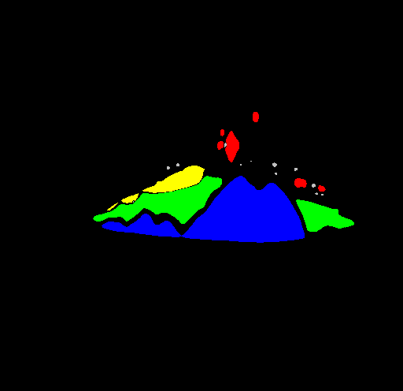
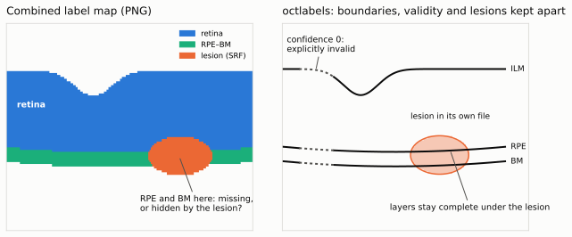

<p align="center"></p>

# octlabels: File Formats and Library for OCT Labels



A lesion file as stored, without any processing:
[`examples/RETOUCH/TRAIN043/lesions/024.png`](examples/RETOUCH/TRAIN043),
the middle B-scan of RETOUCH case TRAIN043 (model output). Red: Cyst,
green: SRF, blue: PED, yellow: SHRM, grey: HRF.

octlabels defines file formats for annotations of OCT (optical coherence
tomography) scans, and a Python library to read, write and process them.

**Documentation:** https://bogunoviclabmuw.github.io/octlabels/

## Why octlabels

OCT annotations are often stored as label maps: one PNG per B-scan in which
every pixel holds a class, the retinal layers as bands between boundaries, and
often the lesions in the same image. That is simple, but it loses information
that matters:

- **A lesion hides what is underneath.** Where a lesion is painted over the
  bands, it is no longer clear whether a boundary does not exist there or was
  simply covered by the lesion.
- **"Not annotated" cannot be stored.** A boundary that the grader could not
  see, a region outside the scan, a layer that does not exist: in a label map
  they all look like some other class.
- **Precision is lost.** Boundaries are rounded to whole pixels, and lesions
  that overlap (such as hyperreflective foci within fluid) cannot be stored at
  all, because a pixel holds only one class.



Other ways of storing OCT annotations have their own problems. Invalid
positions are encoded differently in every dataset (NaN, 0, −1, a separate
mask, or not at all), and misreading them silently corrupts training and
evaluation. Model outputs lose their confidence and uncertainty as soon as
they are saved, because there is nowhere to put them. Vendor formats are
closed, DICOM is rarely used for layer boundaries in practice, MATLAB files
and pickled Python objects tie the data to one tool, and layer names and their
order are often implied by the position in an array instead of being stored.

octlabels stores layer boundaries as what they are, one height per A-scan, with
an explicit validity flag per A-scan and any further per-A-scan values next to
them. Lesions are stored separately as 2D masks, either mutually exclusive
(e.g. fluid compartments) or as overlays that may overlap anything (e.g.
hyperreflective foci). Every file carries the names of what it contains.

The files have further practical advantages:

- **Corrections are visible in version control.** Uncompressed layer files are
  text, so a git diff of a grader's correction shows exactly the A-scans that
  changed.
- **Labels can be shared without images.** The files are small and contain no
  image data, which simplifies exchanging annotations between groups.
- **They remain readable.** Plain YAML and PNG outlive the tools that wrote
  them, which matters for published datasets and long-running studies.

octlabels is meant for anyone who trains or evaluates segmentation models,
grades or corrects annotations, or publishes and exchanges OCT datasets.

## Design goals

The formats are designed to be:

- **Accessible B-scan by B-scan.** Every B-scan has its own file, so one
  B-scan can be read, checked or replaced without loading the whole volume. A
  volume is a folder of these files, or optionally one zip file of them.
- **Built on established standards, independent of this library.** octlabels
  does not invent a new file type: layers and regions are stored in standard
  YAML files, lesions in standard PNG files, and compression and archives use
  gzip, xz and zip. Any YAML parser or image library, in any language, can read
  them; this package is a convenience, not a requirement.
- **Readable by humans.** Layer files are plain text in which all values of an
  A-scan line up in one column, so invalid or suspicious positions are visible
  without any software. Lesion files are PNG images that any image viewer
  displays in color.
- **Easy to parse by machines.** Every layer row holds one number per A-scan
  (comma-separated, or a YAML list); every lesion pixel holds a lesion ID and
  overlay bits, with the lesion names stored as JSON text inside the PNG.
- **Platform independent.** Only UTF-8 text and standard PNG: no custom binary
  layouts or language-specific serialization. Every file is self-describing,
  with names stored next to the data.
- **As small as possible within these constraints.** Layer values are written
  with only the digits they need (plus the padding that aligns the columns),
  and files can be gzip or xz compressed; lesions are bit-packed into one 8-bit
  image per B-scan. On typical scans, a B-scan with 12 layers takes
  about 3 KiB as `.yml.xz`, and its lesion masks 0.5–1.5 KiB as PNG.

Two kinds of annotations are supported:

- **Layers**: retinal layer boundaries (one height per A-scan), biomarker
  regions (presence per A-scan) and any per-A-scan property such as confidence
  or uncertainty.
- **Lesions**: 2D lesion masks, both mutually exclusive ones (e.g. fluids) and
  overlapping ones (e.g. hyperreflective foci).

Dependencies: `numpy`, `pyyaml` and `pillow`.

## Installation

```bash
pip install git+https://github.com/BogunovicLabMUW/octlabels.git
```

## Quick start

```python
import octlabels

# Annotations as arrays: one B-scan file, or a whole volume (folder or zip).
names, values, confidence = octlabels.load_layer_arrays("patient_01/layers/000.yml")
names, values, confidence = octlabels.load_layer_arrays("patient_01/layers/")
names, masks = octlabels.load_lesion_arrays("patient_01/lesions/000.png")
names, masks = octlabels.load_lesion_arrays("patient_01/lesions/", ["IRF", "SRF", "HRF"])

# Arrays back to files.
octlabels.save_layer_arrays("prediction/layers/", values, confidence, names)
octlabels.save_lesion_arrays("prediction/lesions/", masks, names,
                             main_lesion_names=["IRF", "SRF"])

# Annotations as objects; one B-scan of a volume without reading the others.
volume = octlabels.load("patient_01/layers/")        # LayerVolume
bscan = octlabels.load_bscan("patient_01/lesions/", 42)  # LesionSet
```

| Array | Layers | Lesions |
|---|---|---|
| one B-scan | `values`, `confidence`: [layers, width] | `masks`: [lesions, height, width] |
| volume | [B-scans, layers, width] | [B-scans, lesions, height, width] |

Passing `names` selects and orders the annotations; missing ones are zero
(layers: value 0, confidence 0; lesions: empty masks).

## Example data

[`examples/RETOUCH/TRAIN043/`](examples/RETOUCH/TRAIN043) contains the
annotations of one scan of the RETOUCH dataset (case TRAIN043, 49 B-scans of
512 × 496 pixels), produced by a segmentation model. The scan itself is not
included.

- `layers/`: 12 boundaries (ILM … HL-S) with confidence; `info` holds the
  pixel spacing, the laterality and `source: model`.
- `lesions/`: Cyst, SRF, PED, SHRM, Pseudodrusen and ORT as main lesions, HRF
  as an overlay.

The examples are part of the repository, not of the installed package. From
the repository root:

```python
import octlabels

names, values, confidence = octlabels.load_layer_arrays("examples/RETOUCH/TRAIN043/layers")
print(names)         # ['ILM', 'RNFL-GCL', ..., 'BM', 'HL-S']
print(values.shape)  # (49, 12, 512)

names, masks = octlabels.load_lesion_arrays("examples/RETOUCH/TRAIN043/lesions")
print(names)         # ['Cyst', 'SRF', 'PED', 'SHRM', 'Pseudodrusen', 'ORT', 'HRF']
print(masks.shape)   # (49, 7, 496, 512)

bscan = octlabels.load_bscan("examples/RETOUCH/TRAIN043/layers", 24)
print(bscan.info["laterality"], bscan.info["axial_resolution_um"])  # OS 3.872
```

## Concepts

Both kinds are organised the same way:

| | Layers | Lesions |
|---|---|---|
| one annotation | `Layer` (heights), `AScanRegion` (presence per A-scan) | `Lesion` (2D mask) |
| one B-scan | `LayerSet`: `info`, `layers`, `regions` | `LesionSet`: `info`, `lesions` |
| volume | `LayerVolume`: one `.yml` file per B-scan | `LesionVolume`: one `.png` file per B-scan |

The sets and volumes share the same methods: `load`, `save`, `to_array`,
`from_array`, `ensure`, `subset` and `copy`, and volumes also `load_bscan`.
Annotations in a set are accessed by name (`bscan["ILM"]`, `bscan["SRF"]`);
`bscan.layers`, `bscan.regions` and `bscan.lesions` behave like dicts.

## File formats

### Layers: `NNN.yml`

```yaml
info:
  width: 1024
  height: 496
  idx: 0

layers:
  - ILM:
    - values: 338,341,342.5,  0
    - confid:   1,  1,    1,  0
    - uncrtn:  12, 40,  999,  0

regions:
  - DRUSEN:
    - values: 0,1,1,0
```

Every row has one entry per A-scan, and all rows of an annotation are padded
to the same column width, so invalid values (`confid: 0`) stand out. Rows other
than `values`, `confid` and `uncrtn` are custom properties. By default rows are
comma-separated text; with `yaml_arrays=True` they are written as YAML lists
(`values: [338, 341, 342.5, 0]`) so that any YAML tool reads them as numbers.
Both styles are read. Files can be gzip (`.yml.gz`) or xz (`.yml.xz`)
compressed.

### Lesions: `NNN.png`

Each B-scan's lesion masks are packed into one 8-bit indexed PNG:

- **Main lesions** are mutually exclusive (e.g. fluid compartments IRF, SRF,
  PED) and stored as an ID in the low bits of each pixel.
- **Overlays** may overlap anything (e.g. HRF) and use one bit each, from the
  highest bit down.

With the default split of 6 bits a file holds up to 63 main lesions and 2
overlays; `main_lesion_bit_count` moves the split (e.g. 3 bits: 7 main lesions
and 5 overlays). The names and the split are stored as JSON in the PNG, and a
palette makes the file viewable in any image viewer.

### Volumes

A volume is a folder of `000.yml`, `001.yml`, … (or `000.png`, …), named after
the B-scan index. Saving to a path ending in `.zip` writes the same files into
one zip file instead (Deflate by default, which opens in any zip tool;
`compress="lzma"` for the smallest files). Every function that reads volumes
accepts folders and zip files; zip files you create yourself work too, also
with the files in a subfolder.

### Metadata (`info`)

`info` accepts any keys; it is stored in layer files (lesion files store only
the masks and their names). The following keys have a defined meaning; all are
optional, `LayerSet.validate()` checks the ones present, and transforms keep
the resolutions correct (e.g. `resize_horizontal` to half the width doubles
`lateral_resolution_um`). The full list is in `octlabels.INFO_KEYS`.

| Key | Value |
|---|---|
| `width`, `height` | A-scans per B-scan, pixels per A-scan |
| `idx` | index of the B-scan in its volume |
| `axial_resolution_um` | µm per pixel along the A-scan |
| `lateral_resolution_um` | µm between neighbouring A-scans |
| `bscan_spacing_um` | µm between neighbouring B-scans |
| `laterality` | `OD` (right eye) or `OS` (left eye) |
| `subject_id`, `scan_id` | pseudonymous identifiers |
| `device` | acquisition device |
| `source` | `manual`, `model` or `corrected` |
| `grader`, `model` | who or what produced the annotations |
| `format_version` | version of the file format |

Files are meant to be shared: do not store names, birth dates or other direct
patient identifiers.

## Usage

### Load, inspect, save

```python
from octlabels import LayerSet, LayerVolume, LesionSet, LesionVolume

layers = LayerVolume.load("patient_01/layers/")      # folder or .zip
lesions = LesionVolume.load("patient_01/lesions/")

ilm = layers[0]["ILM"]
print(ilm.values, ilm.confidence, ilm.uncertainty)
srf = lesions[0]["SRF"]
print(srf.mask, srf.main)                            # [H, W] uint8, main lesion?

layers.save("out/layers.zip", compress="lzma")
layers[0].save("out/000.yml.xz")                     # compression from the name
lesions.save("out/lesions/")

one = LayerVolume.load_bscan("patient_01/layers/", 42)   # reads only 042.yml
```

### Fixed sets of annotations for training: `ensure`

`ensure` returns a copy with exactly the given annotations, in that order;
missing ones are zero (layers) or empty (lesions). `to_array(names)` does the
same in one step:

```python
values, confidence = layers[0].to_array(["ILM", "RPE", "BM"])   # [3, width]
masks = lesions[0].to_array(["IRF", "SRF", "HRF"])              # [3, H, W]
bscan = layers[0].ensure(["ILM", "RPE", "BM"], region_names=["DRUSEN"])
```

### From model output

```python
from octlabels import LayerVolume, LesionVolume, uncertainty_from_std

layers = LayerVolume.from_array(
    predicted_heights,                     # [B-scans, layers, width]
    confidence=valid,                      # same shape, 0/1
    names=["ILM", "RPE", "BM"],
    info={"height": 496},
    uncertainty=uncertainty_from_std(std), # optional, any further properties too
)
lesions = LesionVolume.from_array(
    predicted_masks,                       # [B-scans, lesions, H, W]
    names=["IRF", "SRF", "HRF"],
    main_lesion_names=["IRF", "SRF"],      # mutually exclusive; HRF is an overlay
)
layers.save("prediction/layers/")
lesions.save("prediction/lesions/")
```

### Layers: custom properties and regions

```python
ilm = layers[0]["ILM"]
ilm.set_property("snr", snr_per_ascan)     # must have one entry per A-scan
ilm.properties["snr"]
layers[0].layers.stack("snr", names=["ILM"])   # [1, width]

layers[0].add_region_raw("IRF", values=irf_presence, confidence=irf_confidence)
layers[0].regions["IRF"].values            # uint8, 0 or 1
```

### Layers: transforms

All transforms return a new `LayerSet`. Layers, regions and every property are
transformed together.

```python
import numpy as np
from octlabels.layers import transforms

flipped = transforms.flip(bscan)
small = transforms.resize_horizontal(bscan, 512)
rotated = transforms.rotate(bscan, np.deg2rad(10))
augmented = transforms.affine(
    bscan, angle_radians=0.05, shear=(0.05, 0), translation=(10, -5), scale=(1.1, 1)
)
```

Confidence is resampled conservatively: an output A-scan is only valid if its
source A-scans are valid and the boundary stays inside the image.

### Layers: segmentation maps

```python
from octlabels.layers import rasterize

masks, band_confidence = rasterize.generate_2d_segmentation(bscan)  # [N+1, H, W]
boundaries = rasterize.generate_boundary_maps(bscan)                # [N, H, W]
positions, confidence = rasterize.extract_boundaries_from_maps(boundaries)
```

### Layers: import from MATLAB `.mat` files (Duke datasets)

Needs optional packages: `pip install "octlabels[matlab]"` (scipy for MATLAB
v5 files, h5py for v7.3 files). They are only imported when you call the
function, and you get this install hint if they are missing.

```python
from octlabels.layers import matlab

volume = matlab.load_duke_mat("Subject_01.mat")    # Duke DME: manualLayers1
volume = matlab.load_duke_mat("Subject_01.mat", variable="manualLayers2")
volume = matlab.load_duke_mat("AMD_Subject_1001.mat", height=512)  # layerMaps

# Any other file with one boundary array; axes is its dimension order
# (L = boundaries, A = A-scans, B = B-scans):
volume = matlab.load_duke_mat("my.mat", variable="boundaries", axes="BLA",
                              names=["ILM", "RPE", "BM"])
volume.save("converted/")
```

NaN boundaries become value 0 with confidence 0, MATLAB's 1-based rows become
0-based, and B-scans without any annotation are skipped (`info["idx"]` keeps
the original index). The height is taken from an `images` array if the file
has one. If a variable is not found, the error lists the file's variables.

### Lesions: main lesions, overlays and the PNG functions

```python
bscan = lesions[0]
bscan.main_lesion_names                  # ['IRF', 'SRF', ...], kept on save
bscan.main_lesion_names = ["IRF", "SRF"] # everything else becomes an overlay
bscan.save("000.png", main_lesion_bit_count=3)   # 7 main lesions, 5 overlays
```

The PNG format can also be used directly with arrays or dictionaries, with
main lesions and overlays passed separately:

```python
from octlabels.lesions import packing

packing.save_lesions("000.png", main, overlays, ["IRF", "SRF"], ["HRF"])
main, overlays, main_names, overlay_names = packing.load_lesions("000.png")

packing.save_lesion_dicts("000.png", {"IRF": irf, "SRF": srf}, {"HRF": hrf})
main, overlays = packing.load_lesion_dicts("000.png")
```

Loading decodes with the bit split stored in the file. Passing
`main_lesion_bit_count` overrides it; that still decodes correctly as long as
all IDs and overlays fit (it warns).

### PyTorch dataset

```python
import torch
from torch.utils.data import Dataset
from octlabels import LayerVolume, LesionVolume


class OCTDataset(Dataset):
    def __init__(self, scan: str, layer_names: list[str], lesion_names: list[str]):
        self.layers = LayerVolume.load(f"{scan}/layers/")
        self.lesions = LesionVolume.load(f"{scan}/lesions/")
        self.layer_names, self.lesion_names = layer_names, lesion_names

    def __len__(self) -> int:
        return len(self.layers)

    def __getitem__(self, idx: int) -> tuple[torch.Tensor, torch.Tensor, torch.Tensor]:
        values, confidence = self.layers[idx].to_array(self.layer_names)
        masks = self.lesions[idx].to_array(self.lesion_names)
        return (
            torch.from_numpy(values),
            torch.from_numpy(confidence).float(),
            torch.from_numpy(masks).float(),
        )
```

## Using octlabels with coding agents

- [`docs/llms.txt`](docs/llms.txt) is a compact usage guide for language
  models, following the [llms.txt](https://llmstxt.org) convention; the
  documentation site serves it at `/llms.txt`.
- [`skills/octlabels/`](skills/octlabels/SKILL.md) is a skill for Claude Code.
  Copy the folder to `.claude/skills/` in your project (or `~/.claude/skills/`
  for all projects), and Claude uses it whenever a task involves OCT labels:

  ```bash
  cp -r skills/octlabels your-project/.claude/skills/
  ```

## Development

```bash
pip install -e ".[dev]"
pytest
ruff check src tests && black --check src tests
```

The documentation in `docs/` is built with MkDocs; every Python example in it
is run by the tests (`tests/test_docs.py`).

```bash
pip install -e ".[docs]"
mkdocs serve          # preview at http://127.0.0.1:8000
mkdocs build --strict # static site in site/
```
